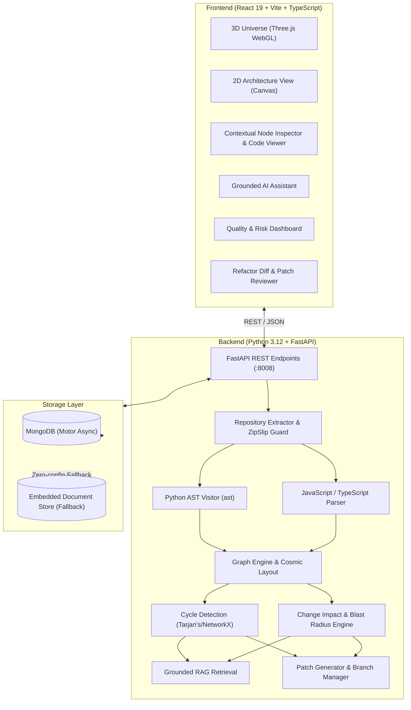

# 🌌 Codebase Universe AI

> **Interactive 3D Software Architecture Intelligence Platform & Visual Codebase Universe**

Transform any software repository into an interactive, navigable 3D visual universe. Codebase Universe AI combines genuine static AST parsing and graph theory with source-grounded AI assistance to help engineering teams explore architectures, detect architectural risks, calculate change blast radius, and execute test-validated refactorings.

---



---

## ✨ Key Capabilities

### 1. 🪐 3D Celestial Codebase Universe
- **Galactic Folders**: Directories cluster into rotating spiral galaxy sectors.
- **Star Systems**: Files shine as luminous stars, color-coded by language (Cyan for Python, Blue for TypeScript, Yellow for JavaScript).
- **Orbiting Planets & Moons**: Classes orbit files as ringed planets, while functions and methods orbit as shimmering satellites.
- **Constellation Links**: Glowing dependency pulses travel along import and call links in real time.
- **Flight & Raycasting Navigation**: Orbit, pan, zoom, click to focus camera smoothly on any code symbol.

### 2. 🗺️ 2D Architecture View
- High-contrast, interactive 2D graph layout for instant structural exploration, relationship inspection, and fast navigation.

### 3. 🧠 Multi-Language Code Intelligence Engine
- **Standard-Compliant AST Parsing**: Extracts functions, async functions, classes, decorators, docstrings, parameters, and return types.
- **Cyclomatic Complexity**: Measures control-flow branches (`if`, `while`, `for`, `except`, `with`, boolean conditions) per function.
- **Call Graph Extraction**: Maps caller-to-callee invocations across modules.
- **Unused Import Detection**: Analyzes bound symbols vs. referenced AST load nodes.

### 4. 🛡️ Code Quality & Risk Analysis
- **Circular Dependency Detection**: Uses NetworkX graph algorithms to identify cyclic import loops (e.g., `A -> B -> A`).
- **God-Component Detection**: Flags oversized files (>350 LOC) and hyper-coupled modules.
- **Architecture Health Score**: Generates a dynamic 0–100 health score with actionable recommendations.

### 5. 💥 Change Impact & Blast Radius Visualizer
- Select any file or function to calculate:
  - **Direct Dependencies**: What this module requires.
  - **Downstream Blast Radius**: Transitive reverse dependency closure.
  - **Regression Test Mapping**: Automatically matches test files (`test_*.py`, `*.test.ts`) that exercise affected code.
  - **3D Universe Shockwave**: Pulses the entire affected blast radius in bright crimson.

### 6. 🤖 Source-Grounded AI Codebase Assistant
- Multi-provider support: **Local Ollama** (default, 100% offline & private), **Google Gemini**, **OpenAI GPT-4o**, or **Offline Heuristic Engine**.
- **Real-Time Token Streaming**: Streams responses via Server-Sent Events (SSE) with sub-2-second Time-to-First-Token and live animated cursor.
- **Custom `codebase-expert` Model**: Tailored Ollama model with physical CPU core binding (`num_thread: 4`), `keep_alive: 60m` warm caching, and high-density, bulleted IT architectural analysis.
- **Zero Hallucination Guarantee**: Every statement cites verified files and exact line numbers (e.g., `[auth/jwt.py:12-28]`).
- Transparently labels verified facts versus hypothetical inferences.

### 7. ⚡ Safe AI-Assisted Refactoring
- Synthesizes clean refactorings based on user objectives (decouple imports, decompose functions, add type hints).
- **Unified Diff Viewer**: Highlights green additions and red deletions before any changes are written.
- **Isolated Branching**: Creates dedicated git branches (`refactor/...`) upon approval, protecting main repository branches.

---

## 🚀 Quickstart Guide

### Prerequisites
- **Node.js** v18+ and **npm**
- **Python** 3.10+ (Python 3.12 recommended)
- **Git**
- *(Recommended)* **Ollama** installed locally (`http://localhost:11434`) for private local AI inference.
- *(Optional)* **MongoDB** (if not installed, Codebase Universe AI automatically uses its zero-config embedded document store).

---

### Step 1: Clone and Configure Environment

```bash
git clone https://github.com/your-username/codebase-universe-ai.git
cd "codebase-universe-ai"
cp .env.example .env
```

Edit `.env` to configure your preferred LLM provider:
```ini
LLM_PROVIDER=ollama        # Options: ollama | gemini | openai | mock
OLLAMA_BASE_URL=http://localhost:11434
OLLAMA_MODEL=codebase-expert
```

To build and optimize the custom `codebase-expert` Ollama model:
```bash
ollama create codebase-expert -f Modelfile
```

### Step 2: Set Up Backend

```bash
# Using uv (recommended for ultra-fast setup):
uv venv .venv
uv pip install -r backend/requirements.txt

# Or using standard python venv:
python -m venv .venv
# Windows:
.venv\Scripts\pip install -r backend\requirements.txt
# macOS/Linux:
source .venv/bin/activate && pip install -r backend/requirements.txt

# Start backend server (runs on http://localhost:8008):
.venv\Scripts\python backend\run.py
```

Verify backend health:
```bash
curl http://localhost:8008/api/health
```

---

### Step 3: Set Up Frontend

```bash
cd frontend
npm install
npm run dev
```

Open your browser at **`http://localhost:5173`** to enter the 3D Codebase Universe!

---

### Running Automated Test Suite

The project includes unit and integration tests covering AST parsers, graph construction, cycle detection, change impact, and API routes:

```bash
uv run pytest backend/tests
```

To verify the frontend production build:
```bash
cd frontend
npm run build
```

---

## 🐳 Docker Deployment

To launch the full stack (MongoDB, FastAPI backend, and Nginx React frontend) via Docker Compose:

```bash
docker-compose up --build
```
Access the application at:
- **Frontend UI**: `http://localhost:5173`
- **Backend API**: `http://localhost:8008/docs`
- **MongoDB**: `localhost:27017`

---

## 🔒 Security & Sandboxing Standards

- **ZipSlip Protection**: Archive unpacking resolves member paths against target boundaries, throwing immediate security alerts on directory traversal attempts.
- **Safe File Access**: File content routes validate absolute canonical paths against repository root boundaries.
- **Credential Isolation**: API keys remain strictly server-side and are never transmitted to the client.
- **Non-Destructive Refactoring**: Changes require explicit user review with unified diff verification and isolate modifications to dedicated git branches.

---

## 📂 Project Structure

```
├── backend/
│   ├── app/
│   │   ├── ai/            # Grounded RAG, LLM providers & refactor engine
│   │   ├── analysis/      # Heuristic quality and architectural health scoring
│   │   ├── db/            # Hybrid MongoDB (Motor) + embedded local store
│   │   ├── graph/         # 3D layout, dependency graph, and impact engine
│   │   ├── models/        # Pydantic schemas (Project, Graph, Findings, Chat)
│   │   ├── parser/        # Python AST & JS/TS structural parsers
│   │   ├── routes/        # FastAPI REST API routes
│   │   └── main.py        # FastAPI entrypoint & auto-seeding
│   ├── fixtures/          # Realistic Python & TypeScript sample microservices
│   ├── tests/             # Pytest test suite
│   ├── requirements.txt   # Python dependencies
│   └── run.py             # Uvicorn runner script
├── frontend/
│   ├── src/
│   │   ├── api/           # Typed REST client
│   │   ├── components/
│   │   │   ├── chat/      # Grounded AI assistant panel
│   │   │   ├── graph2d/   # 2D Canvas structural graph
│   │   │   ├── inspector/ # Node inspector and source code viewer
│   │   │   ├── quality/   # Health dashboard & impact analysis modal
│   │   │   ├── refactor/  # Diff preview & patch application modal
│   │   │   ├── sidebar/   # Repository tree & import modal
│   │   │   ├── ui/        # Cosmic navigation bar
│   │   │   └── universe/  # Three.js 3D WebGL cosmic visualization
│   │   ├── types/         # TypeScript interfaces
│   │   ├── App.tsx        # Main application state and integration
│   │   └── index.css      # Glassmorphism & cyber-space styling
│   ├── package.json
│   └── vite.config.ts
├── docker-compose.yml
├── Dockerfile.backend
├── Dockerfile.frontend
├── .env.example
├── .gitignore
└── README.md
```

---

## 🤝 Collaborative Review Alignment

This architecture was subjected to review roles:
- **Codex Code-Quality & Security Review**: Verified safe archive extraction, validated AST scope-qualified caller mappings, ensured pre-patch content immutability checks, and prevented prose-injection into source files during offline modes.
- **Claude UX & Architecture Review**: Optimized 3D spherical navigation, integrated high-contrast 2D architectural views, provided floating raycast tooltips, and ensured grounded source citations are directly navigable.

---

## 📄 License
Apache-2.0 License. Built for full-stack and AI engineering portfolio demonstration.
