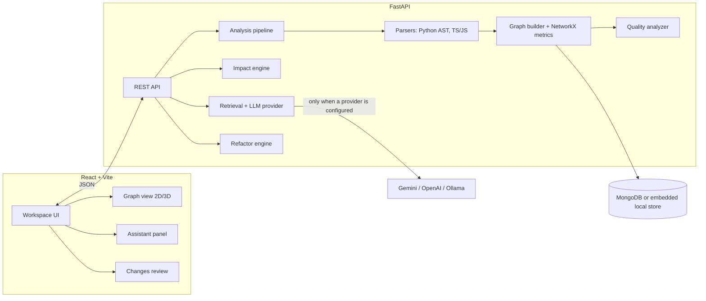

<!--
  Proposed root README for Codebase Universe AI (from the product review).
  Before publishing: replace every "Status" cell with the verified state at release time,
  add real screenshots under docs/images/, and delete this comment.
-->

# Codebase Universe AI

**An interactive map of a codebase, with AI answers that show their evidence.**

Codebase Universe AI parses a repository into a dependency graph of directories, files, classes and functions. You can explore that graph, see what a change would affect, and ask questions that are answered from the source and cite file and line ranges. Each answer separates what the code shows from what the model inferred.


<!-- Shot: select auth/jwt.py → dependents highlight → Ask "what depends on this?" → cited answer → click citation → code opens at the line -->

## Why

Joining an unfamiliar codebase means rebuilding its structure in your head: what imports what, what calls what, and what breaks if you touch something. IDEs answer one file at a time, and general-purpose chatbots answer confidently without showing their evidence. This project combines three things:

1. A **deterministic graph** built by static analysis, so relationships come from the code rather than from a model.
2. **Change-impact analysis** on top of that graph: direct dependents, transitive blast radius and likely related tests.
3. An **AI assistant that stays grounded**: answers cite source lines and separate *verified*, *inferred* and *unknown*. The assistant never claims something was run or tested; only the system reports that.

## Features

| Feature | What it does | Status |
|---|---|---|
| Import | Built-in samples, `.zip` upload, local folder (local mode) | Available (API) |
| Analysis pipeline | Parse → graph → quality checks, with progress status | Available (API) |
| Languages | Python (AST), TypeScript/JavaScript | Python full; TS without call-level callers |
| Dependency graph | Directories, files, classes, functions; imports, calls, inheritance | Available (API) |
| Graph explorer | 2D map with 3D "Universe" view, search, filters, inspector | Planned / in progress |
| Quality report | Import cycles, complexity, coupling, large files, orphans, heuristic health score | Available (API) |
| Change impact | Dependents, blast radius, likely tests, suggested test command | Available (API) |
| Grounded Q&A | Retrieval over the graph + source; citations with line ranges | Available (API) |
| Change proposals | AI-generated diff for review; apply to a new git branch | Experimental, see Limitations |
| Test validation | Run the project's tests for a proposal | Off by default (`ENABLE_TEST_RUNNER`) |

## Architecture



- **Static first:** the graph, metrics, findings and impact are computed without an LLM. The AI layer reads from them; it does not produce them.
- **Storage:** MongoDB when reachable, otherwise an embedded local JSON store, so a database is not required.
- **LLM providers:** Gemini, OpenAI, or Ollama for fully local use. Without one, chat returns the retrieved sources only and change proposals are disabled.

## Getting started

Prerequisites: Python 3.11+ (requires the `Tuple` import fix from the product review; until then 3.14+), Node 20+. MongoDB and an LLM key are optional.

```bash
# 1. Configure
cp .env.example .env            # add GEMINI_API_KEY / OPENAI_API_KEY, or set LLM_PROVIDER=ollama

# 2. Backend
cd backend
python -m venv .venv && source .venv/bin/activate    # Windows: .venv\Scripts\activate
pip install -r requirements.txt
python run.py                    # http://localhost:8000  (API docs at /docs)

# 3. Frontend
cd ../frontend
npm install
npm run dev                      # http://localhost:5173
```

On first start, two sample projects are indexed automatically.

### Configuration

| Variable | Default | Purpose |
|---|---|---|
| `LLM_PROVIDER` | `gemini` | `gemini`, `openai`, `ollama` |
| `GEMINI_API_KEY` / `OPENAI_API_KEY` | empty | Provider credentials. Never commit `.env`. |
| `OLLAMA_BASE_URL`, `OLLAMA_MODEL` | `http://localhost:11434`, `codellama:latest` | Local model, so no code leaves the machine |
| `MONGODB_URI` | `mongodb://localhost:27017` | Falls back to the local store if unreachable |
| `MAX_UPLOAD_SIZE_MB` | `50` | ZIP upload limit |
| `ENABLE_TEST_RUNNER` | `false` | Runs repository tests, which means **executing untrusted code**. Enable only for repos you trust. |

**Data handling:** with a cloud provider configured, code snippets relevant to each question are sent to that provider. Use Ollama to keep everything local. Uploaded repositories are stored under `backend/storage/`. Delete a project in the UI or via `DELETE /api/projects/{id}` to remove them.

## Five-minute demo

Uses the built-in **Financial Microservice (Python)** sample.

1. **Open the sample.** The health strip reports an import cycle and a high-complexity function.
2. **Find the cycle.** Open *Findings* → "Circular Dependency". `auth/jwt.py` and `auth/user.py` import each other, and both edges are highlighted red in the graph.
3. **Inspect a dependency.** Select `auth/jwt.py`. The inspector lists *Used by* (`auth/user.py`, `core/engine.py`, `tests/test_auth.py`). Click one to open the code at the import line.
4. **Ask a grounded question.** "Is token verification secure?" The answer cites `auth/jwt.py:12–15` under **Verified**, flags forgeable tokens under **Inferred**, and lists what it couldn't confirm under **Unknown**.
5. **Check impact.** Click *Impact* on `verify_token` to see the dependents, the blast radius and `tests/test_auth.py` as a likely test.
6. **Review a proposal** *(needs an LLM provider)*. On `CoreEngine.process_transaction`, choose "Propose fix" for the complexity finding. Review the diff, note the test status (`Not run` unless the runner is enabled), then discard or apply to a new branch.

## Screenshots

<!-- Capture at 1440×900, dark theme, sample Python project -->
| | |
|---|---|
|  Graph with inspector |  Cited answer with evidence blocks |
|  Change impact |  Proposal review with test status |

## Design decisions

- **2D by default, 3D optional.** 2D keeps labels readable, works with the keyboard, and scales further. The 3D view is for orientation.
- **Confidence is drawn, not hidden.** Imports resolved by path are solid lines. Calls resolved only by name are dashed, and ambiguous ones are dotted.
- **System facts vs model text.** "Tests passed" and "file written" come only from backend results, never from the assistant's prose.
- **Apply needs confirmation.** Proposals are diffs first. Writing to disk is an explicit, confirmed step on a new branch.

## Limitations

- Call relationships are resolved **by name**, so they can point to the wrong symbol when names repeat. They are marked as inferred.
- TypeScript/JavaScript parsing doesn't attribute calls to the calling function.
- The health score is a weighted heuristic. Use its breakdown, not the number alone.
- "Related tests" are matched by file name and the dependency graph, not by coverage data.
- The test runner (when enabled) has a 12-second timeout and no sandbox.
- Git URL import is not implemented.

## Future work

- Run proposal tests against the *patched* code in an isolated copy
- Coverage-based test mapping
- Type-aware call resolution (e.g. Pyright / TypeScript compiler API)
- Additional languages through tree-sitter

## Tech stack

FastAPI · Pydantic · NetworkX · Python `ast` · React 19 · TypeScript · Vite · Three.js · MongoDB (optional)

## Tests

```bash
cd backend && pytest tests
```
